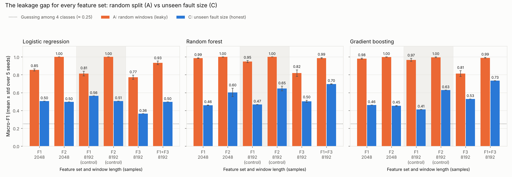
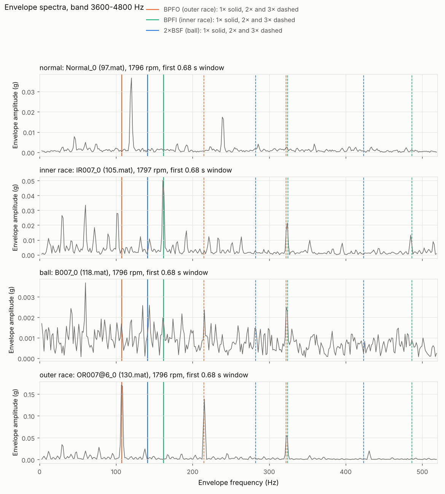

# Bearing-fault classifiers on CWRU: an honest evaluation

Many machine-learning papers report about 99% accuracy at diagnosing
bearing faults on the Case Western Reserve University (CWRU) dataset. This
project asks two questions:
- how much of that 99% survives a fair test;
- do features built from bearing physics do better than generic ones?

**Short answer:**
- **Most of the 99% is leakage.** The same models drop from **0.99 to
  about 0.46-0.50** macro-F1 when tested on bearings they have never seen.
  Guessing scores 0.25.
- **Physics-informed features help, but only in combination and only where
  the physics is present in the data.** Generic plus physics features
  reach **0.73**. Physics features alone do not beat generic ones.



## What "leakage" means here

Each CWRU recording is 10 seconds long. The usual approach cuts every
recording into hundreds of short windows and then splits the *windows*
randomly into training and test sets. Windows from the same recording end
up on both sides. A model can then score highly by recognising the
recording (its loudness, noise and quirks) without learning anything about
the fault.

It is like studying for an exam from questions cut out of the same
problems that the exam is drawn from. [docs/HOW_IT_WORKS.md](docs/HOW_IT_WORKS.md)
explains it in plain English.

Three ways of testing, from leaky to honest:

| Protocol | Test set | Shared with training | Best macro-F1 (feature set F1) |
|---|---|---|---|
| **A**: random windows | 20% of all windows | the recordings themselves | **0.99** |
| **B**: unseen load | everything at 3 HP | the same physical bearings, at other loads | **0.97** |
| **C**: unseen fault size | one fault size per fold, 3 folds | only the single healthy bearing | **0.50** |

Protocol B looks honest but is not. CWRU recorded each damaged bearing at
all four motor loads, so a "new load" is still a bearing the model has
studied. Protocol C, which tests on fault sizes never seen in training, is
the honest benchmark here.

## Results

Macro-F1 under protocol C, mean over 5 seeds (the full table is in
[docs/RESULTS.md](docs/RESULTS.md)):

| Feature set | Logistic regression | Random forest | Gradient boosting |
|---|---|---|---|
| F1: 7 generic statistics (RMS, kurtosis, ...) | 0.50 | 0.46 | 0.46 |
| F2: 16 spectral band energies | 0.50 | 0.60 | 0.45 |
| F3: physics-informed envelope features | 0.36 | 0.50 | 0.53 |
| **F1 + F3** | 0.50 | **0.70** | **0.73** |

F1 and F2 use 0.17 s windows (2048 samples). F3 and F1 + F3 use 0.68 s
windows (8192 samples), because shorter windows cannot separate the fault
frequencies. Control runs of F1 and F2 on the longer windows (0.41-0.65)
show the gain is not just from window length.

- **RQ1, leakage:** random windows score 0.25-0.56 higher than unseen
  fault sizes, across all feature sets and models.
- **RQ2, physics features:**
  - With F1 + F3, inner-race (0.007 and 0.021 in) and outer-race (0.007 in)
    faults go from 0-10% recognised (tree models, generic features) to
    **100%**.
  - Ball faults and 0.014 in outer-race faults stay unsolved. Neither shows
    a physical fault signature in the data.
  - With only three held-out fault sizes, the lead over the best generic
    features (0.65, with the same longer windows) is not statistically
    secure.
- **RQ3, simple models:** logistic regression is as good as tree models
  with generic features, but cannot use the physics features.

The physics features are measured by envelope analysis: listening for the
*rhythm* of impacts, not their loudness. The best model's most important
feature is the envelope peak at the inner-race fault frequency (BPFI):



## Data checks that shaped the results

Before any model was trained, every file was checked. Several findings
matter for anyone using CWRU ([docs/VALIDATION.md](docs/VALIDATION.md)):

- **The healthy files were recorded at 48 kHz, not 12 kHz.** Sources
  disagree on this. The data settles it: read as 12 kHz, the healthy files
  show peaks at exactly ¼, ½ and ¾ of shaft speed, which are their true
  1×, 2× and 3×. They are resampled to 12 kHz.
- **The healthy files were recorded on different equipment settings.**
  Even after resampling they differed from the faulty files by up to 59 dB
  near 5-6 kHz, a free shortcut for a classifier. Every signal is now
  low-pass filtered at 5 kHz, and features use 0-4.8 kHz only.
- **File 99 contains a copy of file 98's signal.** It is reported and not
  used.
- **Only 26 of 40 recordings clearly show the fault their label claims.**
  No ball recording shows a sharp ball-fault line, and the 0.021 in ball
  files look like inner-race faults. The labels are kept as published, and
  results are reported per class.
- **All 40 files match CWRU's official site** in name, label and file size
  to the byte.

## Rules the evaluation follows

- Nothing is fitted on test data: scalers, class weights and the
  physics-feature frequency band all learn from training data only.
- The train/test protocols were fixed before any result was seen. Nothing
  is tuned.
- Every result is reported per class and per fault size, and negative
  results are reported plainly.
- More than 100 automated tests check the pipeline. For example: no window or faulty
  recording is ever on both sides of an honest split, and scrambling the
  test labels never changes a prediction.

## Reproduce it

Python 3.13 with numpy, scipy, pandas, scikit-learn and matplotlib (pinned
versions in `requirements.txt`), CPU only. The project never downloads
anything. The 40 CWRU `.mat` files are in `data/raw/`, as obtained from the
[CWRU Bearing Data Center](https://engineering.case.edu/bearingdatacenter).

1. Install the libraries:

   ```bash
   pip install -r requirements.txt
   ```

2. Run the data checks:

   ```bash
   python -m src.load_data
   ```

   ```bash
   python -m src.check_sampling_rate
   ```

   ```bash
   python -m src.check_band_edge
   ```

   ```bash
   python -m src.check_fault_signatures
   ```

   ```bash
   python -m src.check_physics_features
   ```

3. Run the full experiment (about 9 minutes):

   ```bash
   python -m src.run_experiments
   ```

4. Run the tests:

   ```bash
   python -m unittest discover -s tests -v
   ```

Re-running gives identical numbers.

## Repository map

| Path | What it is |
|---|---|
| `src/config.py` | every fixed fact: file list, labels, bearing geometry, sampling rates |
| `src/load_data.py` | loads, checks and lists the recordings; the single source of signals |
| `src/check_*.py` | the data checks (sampling rate, band edge, fault signatures, physics features) |
| `src/segment.py`, `src/features.py` | windows and the feature sets F1, F2, F3 |
| `src/splits.py` | the three protocols A, B and C |
| `src/run_experiments.py` | the full grid: 6 feature sets × 3 protocols × 3 models × 5 seeds |
| `docs/RESULTS.md` | the research questions, answered with numbers |
| `docs/VALIDATION.md` | evidence that every step is correct, and every data finding |
| `docs/HOW_IT_WORKS.md` | plain-English guide for non-programmers |
| `CHANGELOG.md` | what was done in each working session |
| `results/` | every table and figure, written by the scripts |

## Limits

- One test rig and three faulty bearings per fault type, so protocol C has
  only three folds, and scores swing widely between them (0.36-1.00 for
  the best model).
- The healthy class has one bearing, shared between training and test in
  every protocol, so its near-perfect scores say little.
- Labels are kept as published, even for the 14 recordings whose physics
  disagrees.
- Nothing here shows how a model would do on a different machine.

## References

- CWRU Bearing Data Center, https://engineering.case.edu/bearingdatacenter
  (data, bearing geometry and fault specifications; checked 2026-11-02).
- W. A. Smith and R. B. Randall (2015), *Rolling element bearing
  diagnostics using the Case Western Reserve University data: a benchmark
  study*, Mechanical Systems and Signal Processing 64-65, 100-131.
