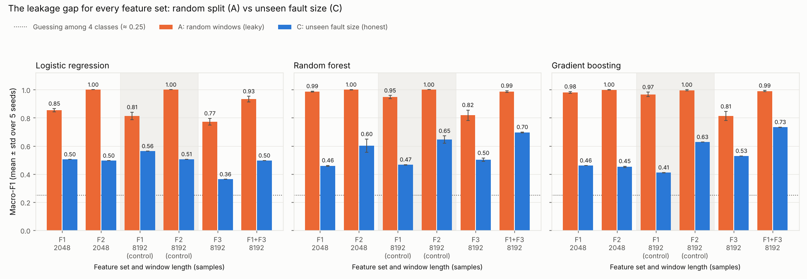
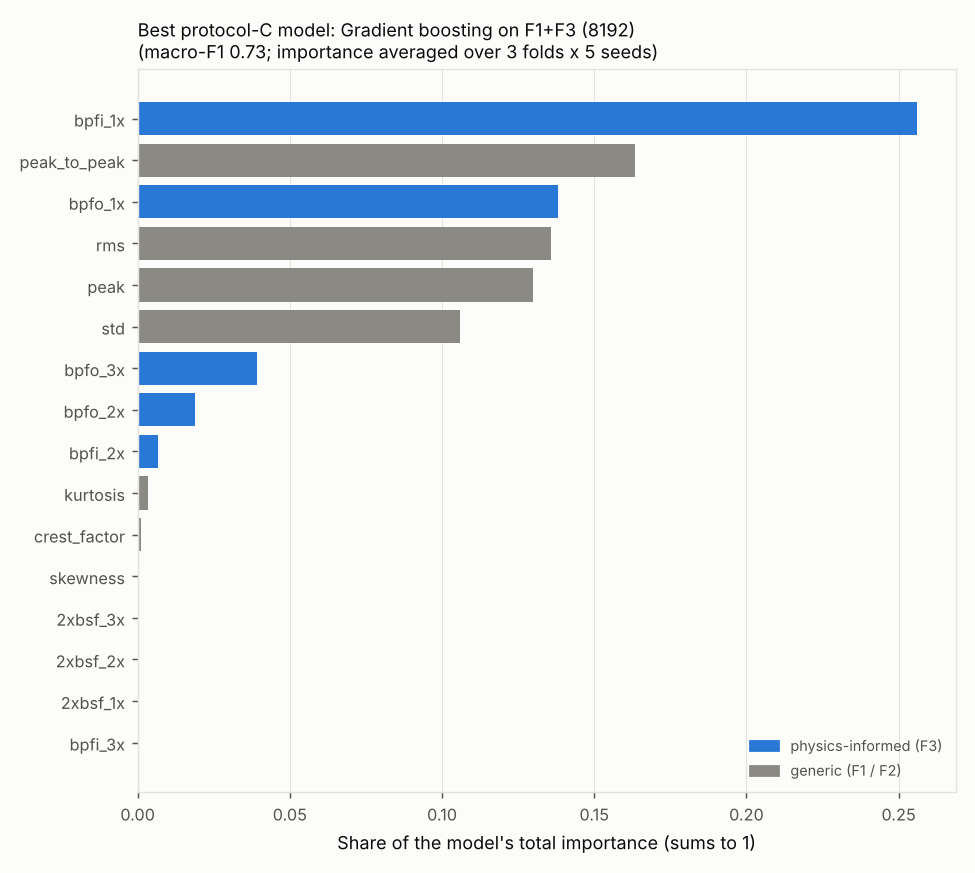
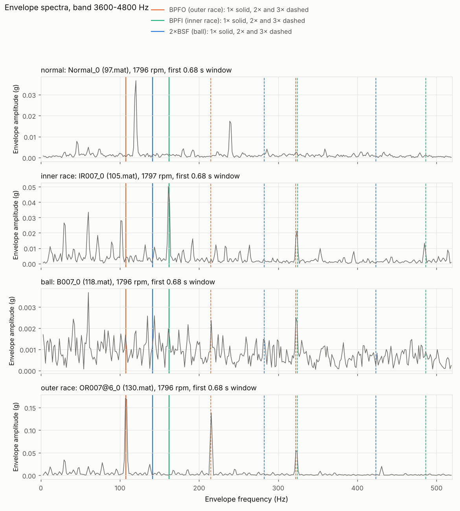

# Results (2026-11-02)

An honest evaluation of bearing-fault classifiers on the CWRU dataset.

**The grid:**
- 40 recordings, 4 classes (normal, inner race, ball, outer race);
- 3 ways of testing (protocols A, B, C);
- 6 feature-set configurations;
- 3 models;
- 5 seeds.

Every number comes from `python -m src.run_experiments`. The headline table
is `results/results_all.csv`, and all runs are in `results/results_all_runs.csv`.

| Protocol | What is tested | What is still shared with training |
|---|---|---|
| A: random 80/20 | random windows | the recordings themselves (deliberately leaky) |
| B: unseen load | 3 HP, trained on 0-2 HP | the same physical bearings, at other loads |
| C: unseen fault size | 3 folds, each holding out one fault size | only the single healthy bearing |

Protocol C is the honest benchmark. Macro-F1 is 1.0 for perfect and about
0.25 for guessing.

---

## The three research questions

**RQ1. How much does leakage inflate macro-F1?**
By **0.25 to 0.56** (protocol A minus protocol C), across all 18
combinations of feature set and model. With the generic features (F1), the
random forest scores **0.99** on random windows but **0.46** on unseen fault
sizes. Testing on an unseen load (B) keeps almost all of the inflation
(**0.97**), because B still tests on bearings the model has already studied.

**RQ2. Do physics-informed features generalise better?**
**Not on their own, but they help when combined with generic features.**
- **On their own:** the physics features (F3) score **0.36-0.53** under
  protocol C, no better than generic features on the same 8192-sample
  windows (F1 0.41-0.56, F2 0.51-0.65).
- **Combined with F1:** they give the best honest scores, **0.73** with
  gradient boosting and **0.70** with random forest, against 0.41 and 0.47
  for F1 alone. The gain is exactly where the physics predicts:
  - inner race 0.007 and 0.021 in, and outer race 0.007 in, go from 0-10%
    correct (tree models with F1) to **100%**;
  - ball and outer race 0.014 in, which show no physical signature (see
    VALIDATION 4.2), stay unsolved.
- **The margin is not secure.** There are only three held-out fault sizes,
  and the folds vary from 0.36 to 1.00. The lead over the best generic
  control (F2 on 8192 samples, 0.65) is not statistically secure.

**RQ3. Do simple models suffice?**
**Only with generic features.**
- With F1, logistic regression is the best honest model (**0.50-0.56**,
  against 0.41-0.47 for the trees).
- It cannot exploit the physics features: it scores **0.36** on F3 and
  **0.50** on F1+F3, while gradient boosting reaches **0.73** on F1+F3.
- A simple model is enough to expose leakage, but not to get the best
  generalisation.

### Negative results, stated plainly
- **F3 alone does not beat generic features** under protocol C. It also
  recognises healthy windows worse: only 67-81% of them, against 100% with
  F1. The physics features describe faults, not health.
- **No model recognises ball faults on an unseen ball.** "Ball" is the
  default answer instead. The best model labels half of all faulty test
  windows "ball", and only 55% of its "ball" answers are right.
- **Outer race 0.014 in scores 0% for every feature set and model.**
- **Inner race 0.014 in fails even with F3**, although its BPFI line is
  clear. Every one of its windows is called "ball" (see below).
- **The 0.014 in fold is near chance for everything** (macro-F1 0.17-0.58).
- **Logistic regression gets worse with physics features** (0.56 → 0.36 →
  0.50 for F1 → F3 → F1+F3, all on 8192 samples).

---

## Supporting detail

### Headline: protocol A vs C for every feature set

Macro-F1 under protocol C (unseen fault size), mean ± std over 5 seeds:

| Feature set (window) | Logistic regression | Random forest | Gradient boosting |
|---|---|---|---|
| F1 generic (2048) | 0.504 ± 0.000 | 0.458 ± 0.004 | 0.460 ± 0.001 |
| F2 spectral (2048) | 0.495 ± 0.000 | 0.602 ± 0.046 | 0.451 ± 0.006 |
| F1 generic (8192), control | **0.563** ± 0.000 | 0.466 ± 0.002 | 0.410 ± 0.001 |
| F2 spectral (8192), control | 0.506 ± 0.000 | 0.646 ± 0.025 | 0.628 ± 0.000 |
| F3 physics (8192) | 0.363 ± 0.000 | 0.502 ± 0.012 | 0.528 ± 0.001 |
| F1+F3 (8192) | 0.496 ± 0.000 | **0.696** ± 0.003 | **0.732** ± 0.002 |

Under protocol A every set scores 0.77-1.00. F2 reaches **1.00**: band
energies fingerprint a recording almost perfectly, which makes F2 the
leakiest set (A − C up to 0.55). F3 scores lowest under A (0.77-0.82),
so it memorises recordings least.

Why two "control" rows: F3 needs longer windows (next section). Without
F1 and F2 on the same 8192-sample windows, any gain could be credited to
the physics when it came from the longer windows. The controls show that
longer windows alone help F2 (gradient boosting 0.45 → 0.63) but not F1.

### Per class and per fault size (protocol C, gradient boosting)

Share of test windows correct. \* = flagged group: no matching physical
signature (VALIDATION 4.2-4.3).

| Group | F1 (2048) | F2 (8192) | F3 (8192) | F1+F3 (8192) |
|---|---|---|---|---|
| Normal | 1.00 | 1.00 | 0.67 | 1.00 |
| Inner race 0.007 | 0.01 | 0.00 | **1.00** | **1.00** |
| Inner race 0.014 | 0.00 | 1.00 | 0.43 | 0.00 |
| Inner race 0.021 | 0.06 | 0.00 | **1.00** | **1.00** |
| Ball 0.007 \* | 1.00 | 1.00 | 0.27 | 0.98 |
| Ball 0.014 \* | 0.87 | 1.00 | 0.42 | 1.00 |
| Ball 0.021 \* | 0.74 | 1.00 | 0.09 | 0.48 |
| Outer race 0.007 | 0.00 | 0.75 | **1.00** | **1.00** |
| Outer race 0.014 \* | 0.00 | 0.00 | 0.00 | 0.00 |
| Outer race 0.021 | 1.00 | 1.00 | 0.89 | 0.95 |

All models and feature sets are in `results/results_all_by_group.csv`.

Reading the table:
- **High ball scores are the "default answer" effect**, not ball recognition
  (see the precision figures under the negative results).
- **F2's 1.00 on inner race 0.014 sits beside 0.00 on 0.007 and 0.021.**
  That pattern looks like fold-specific luck rather than a learned
  inner-race signature.

**Why inner race 0.014 fails with F3.**
- Its BPFI line is clear: about 15× the background, against 1-7× for every
  non-inner-race group. But it is weaker than in the inner-race faults the
  model trained on (27-37×).
- In that fold, the "ball" training windows include ball 0.021, whose
  envelope looks like an inner-race fault (about 7×, VALIDATION 4.2).
- The trees put the boundary between those levels, and inner race 0.014
  lands on the ball side: all 56 of its windows are called "ball".
- This is consistent with the label problem found earlier feeding straight
  into a model failure. It is not proven.

### Protocol C per held-out fault size (macro-F1, mean over seeds)

| Held out | F1 (2048) GB | F2 (8192) GB | F3 GB | F1+F3 GB | F1+F3 RF |
|---|---|---|---|---|---|
| 0.007 in | 0.42 | 0.64 | 0.62 | **1.00** | **1.00** |
| 0.014 in | 0.32 | 0.58 | 0.33 | 0.36 | 0.35 |
| 0.021 in | 0.64 | 0.67 | 0.64 | 0.85 | 0.74 |

Seed-to-seed spread is tiny (≤ 0.05). The uncertainty that matters is which
bearings happen to be tested, and with 3 faulty bearings per fault type it
cannot be reduced.

### What the best protocol-C model relies on

Gradient boosting on F1+F3 (importance averaged over 3 folds × 5 seeds):
- **`bpfi_1x` is the single most important feature (0.26).** `bpfo_1x`
  follows at 0.14, and F3 carries 0.46 of the total.
- The amplitude features (peak-to-peak, RMS, peak, std) carry most of the
  rest.
- The three 2×BSF (ball) features carry almost nothing (< 0.001), as
  expected given that no ball file shows a ball line.

---

## Method notes and decisions

**Feature sets** (details in `src/features.py`):
- **F1:** 7 generic statistics (RMS, peak, peak-to-peak, crest factor,
  kurtosis, skewness, std).
- **F2:** log energy in 16 equal bands of 300 Hz from **0 to 4.8 kHz**.
  - The brief asked for 0-6 kHz. Above 4.8 kHz the healthy recordings still
    differ from the faulty ones because of how they were recorded
    (VALIDATION 3.5), so the project rule limits features to 0-4.8 kHz.
  - The tiny residual difference above 5.2 kHz would become a large,
    perfectly separating feature after scaling.
- **F3:** envelope analysis. The steps are:
  1. band-pass filter in a band **chosen from training windows only**:
     the one of nine 1.2 kHz bands (0.4-4.8 kHz) with the highest median
     kurtosis;
  2. take the Hilbert envelope and its spectrum;
  3. measure the peak at 1×, 2× and 3× of BPFO, BPFI and 2×BSF from each
     recording's own RPM, within ±1% or one bin, whichever is wider;
  4. divide by the median of the envelope spectrum over 10-600 Hz and take
     log10.

  The bands chosen were:
  - A: 2.4-3.6 or 3.6-4.8 kHz;
  - B: 3.6-4.8 kHz;
  - C: 3.6-4.8 kHz (0.007 fold), 2.8-4.0 kHz (0.014 and 0.021 folds).

  The record is `results/f3_bands_chosen.csv`.

**Why F3 uses 8192-sample windows.** A 2048-sample window gives 5.86 Hz
bins, and a Hann window needs about 2 bins between peaks. At 1730 rpm,
where lines are closest:

| Line | Nearest neighbour | Gap | Bins at 2048 | Bins at 8192 |
|---|---|---|---|---|
| 3×BPFO 310.1 Hz | 2×BPFI 312.3 Hz | 2.2 Hz | 0.4 | 1.5 |
| 2×BSF 135.9 Hz | BPFO + 1× 132.2 Hz | 3.7 Hz | 0.6 | 2.5 |
| 3×(2×BSF) 407.7 Hz | 14× shaft 403.7 Hz | 4.1 Hz | 0.7 | 2.8 |
| 2×BPFO 206.7 Hz | 7× shaft 201.8 Hz | 4.9 Hz | 0.8 | 3.3 |

- At 2048 samples only 3 of the 9 lines are separated; at 8192 samples
  (1.46 Hz bins), 7 of 9.
- The remaining pair, 3×BPFO and 2×BPFI, is only 0.7% apart, about the size
  of real slip. No window length separates it in practice, so those two
  features partly measure the same peak.
- **The trade-off:** 4× fewer examples (554 windows instead of 2331; 49
  healthy) for a 4× sharper spectrum. The full table is
  `results/f3_resolution_check.csv`.

**Sanity check of F3** (`python -m src.check_physics_features`, band chosen
from all windows without labels):

| Recordings | Test | Windows passing |
|---|---|---|
| Inner race, all sizes | BPFI level > BPFO level | **100%** (169/169) |
| Outer race, all sizes | BPFO level > BPFI level | **84%** |
| … outer race 0.007 / 0.014 / 0.021 | BPFO > BPFI | 100% / **52%** / 100% |

Outer race 0.014 is a coin flip, matching the earlier finding that it shows
no BPFO signature.

**Fairness rules applied throughout:**
- Scalers, class weights and the F3 band are learned from training data
  only, separately for every split.
- Nothing is tuned.
- The "best model" in the importance chart is picked on test scores, for
  display only; every model is reported.
- The F1 (2048) results reproduce session 4 exactly.

**Limits:**
- Only three faulty bearings per fault type, so protocol C has three folds
  and large fold-to-fold swings.
- The healthy class always shares its one bearing between training and
  test, and was recorded differently.
- The labels are kept as published even where the physics disagrees (14
  files).
- One dataset, one rig, so none of this shows how a model would do on a
  different machine.
