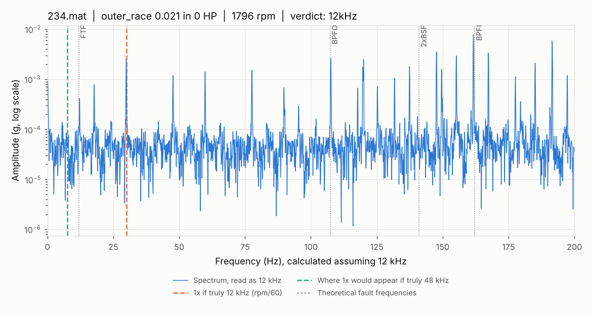

# Validation: version 1 (2026-11-01)

This document holds the evidence that each step of the project does what it
claims. Every number here comes from a script in `src/` and is checked by a
test in `tests/`, except where a section says otherwise.

**Scope of this version:** only **5 of the 40 planned files** are in
`data/raw/`. Every data finding below applies to those five files only.

---

## 1. Data inventory and quality

Source: `python -m src.load_data`, which writes `results/manifest.csv` and
`results/data_quality_report.txt`.

### 1.1 What is present

| File | Condition | Fault size | Load | Stored rpm | Nominal rpm | Samples | Duration |
|---|---|---|---|---|---|---|---|
| 225 | Ball | 0.021 in | 3 HP | 1729 | 1730 | 122,136 | 10.18 s |
| 234 | Outer race @ 6:00 | 0.021 in | 0 HP | 1796 | 1797 | 122,426 | 10.20 s |
| 235 | Outer race @ 6:00 | 0.021 in | 1 HP | 1771 | 1772 | 121,991 | 10.17 s |
| 236 | Outer race @ 6:00 | 0.021 in | 2 HP | 1748 | 1750 | 122,281 | 10.19 s |
| 237 | Outer race @ 6:00 | 0.021 in | 3 HP | 1721 | 1730 | 121,991 | 10.17 s |

### 1.2 Findings

1. **35 of 40 files are missing**, including all four normal files (97-100),
   every inner-race file, and every 0.007 in and 0.014 in file. The full
   list is in `results/data_quality_report.txt`.
2. **The two questions about the normal files cannot be answered yet:**
   - whether one normal file is a copy of another,
   - whether the normal files are 12 kHz or 48 kHz.

   The code to answer both is written and tested on synthetic data. It will
   run automatically once files 97-100 are added.
3. **No duplicates among the five files present.** No two drive-end signals
   are identical. None share even their first 1,000 samples.
4. **The file structure is clean.** Each file holds exactly one drive-end
   signal named after its file number (e.g. `X234_DE_time`), plus fan-end
   (`_FE_time`) and base (`_BA_time`) signals and a stored RPM. None
   contains NaN or infinite values.
5. **The stored RPM is the measured speed, and it differs from nominal.**
   Four files are within 1-2 rpm of nominal. **File 237 is 9 rpm below
   nominal** (1721 vs 1730, -0.5%). That moves every fault frequency by
   0.5% (BPFO by about 0.5 Hz), which matters when a feature looks in a
   narrow frequency band. We use the stored value.
6. **The present data cannot support a classifier.** It covers two
   conditions: outer race (4 files) and ball (1 file, 3 HP only). There are
   no normal or inner-race files. With one ball recording, no honest split
   can put a ball recording in both training and test.

---

## 2. Bearing fault frequencies

Source: `src/bearing_physics.py`, tested in `tests/test_bearing_physics.py`.

### 2.1 Formulas

Symbols: n = number of balls, d = ball diameter, D = pitch diameter,
φ = contact angle, f_r = shaft speed in Hz (rpm / 60).

| Frequency | Meaning | Formula |
|---|---|---|
| FTF | cage (ball holder) rotation | f_r / 2 × (1 − d/D cos φ) |
| BPFO | balls passing a point on the outer race | n f_r / 2 × (1 − d/D cos φ) |
| BPFI | balls passing a point on the inner race | n f_r / 2 × (1 + d/D cos φ) |
| BSF | one ball spinning about its own axis | D / (2d) × f_r × (1 − (d/D cos φ)²) |

Assumptions: outer race fixed, inner race turning with the shaft, pure
rolling (no slip). Real bearings slip slightly, so measured fault
frequencies are often 1-2% off these values.

### 2.2 Hand calculation at 1797 rpm

Bearing: n = 9, d = 7.94 mm, D = 39.04 mm, φ = 0°.

1. **Shaft frequency:** f_r = 1797 / 60 = **29.95 Hz**
2. **Geometry ratio:** d/D × cos φ = 7.94 / 39.04 × cos 0° = 0.203381 × 1 = **0.203381**
   - 1 − 0.203381 = 0.796619
   - 1 + 0.203381 = 1.203381
   - 0.203381² = 0.041364, so 1 − 0.041364 = 0.958636
3. **FTF** = 29.95 / 2 × 0.796619 = 14.975 × 0.796619 = **11.929 Hz**
4. **BPFO** = 9 × 29.95 / 2 × 0.796619 = 134.775 × 0.796619 = **107.364 Hz**
5. **BPFI** = 134.775 × 1.203381 = **162.186 Hz**
6. **BSF** = 39.04 / (2 × 7.94) × 29.95 × 0.958636 = 2.458438 × 29.95 × 0.958636 = **70.585 Hz**
7. **2 × BSF** = **141.169 Hz**

Cross-checks that follow from the formulas (both are tests):
- BPFO + BPFI = n × f_r: 107.364 + 162.186 = 269.550 = 9 × 29.95 ✓
- BPFO = n × FTF: 9 × 11.929 = 107.364 ✓

Values at all four nominal speeds are in `results/fault_frequencies.csv`.

### 2.3 Comparison with CWRU's published multipliers

| | Ours (from geometry) | CWRU published | Difference |
|---|---|---|---|
| BPFI | 5.41522 | 5.4152 | +0.00002 |
| BPFO | 3.58478 | 3.5848 | −0.00002 |
| FTF | 0.39831 | 0.3983 | +0.00001 |
| BSF (standard) | 2.35675 | none | none |
| 2 × BSF | 4.71350 | 4.7135 ("rolling element") | −0.000005 |

Every difference is smaller than CWRU's rounding to 4 decimals. **Our
formulas and geometry reproduce CWRU's numbers.**

### 2.4 Finding: CWRU's "rolling element" frequency is 2 × BSF

The standard formula gives **BSF = 2.3567 × shaft speed**. CWRU's published
**4.7135** equals **2 × 2.356748 = 4.713495**, which rounds to 4.7135. They
are the same to the last published digit.

Why 2×: a defect on a ball touches the outer race and then the inner race
during each spin, so it makes **two impacts per ball revolution**. 2 × BSF is
therefore where ball-fault impacts usually appear, and that is a sensible
number to publish. It is **not** what textbooks call BSF, though.

Consequences for this project:
- In code and reports, we write **BSF = 2.357×** and **2×BSF = 4.714×**,
  never "BSF = 4.7135".
- Ball-fault features should look at 2 × BSF as well as BSF.
- A test (`test_cwru_rolling_element_value_is_not_bsf`) stops anyone from
  "correcting" BSF to 4.7135.

---

## 3. Sampling-rate check

Source: `python -m src.check_sampling_rate`, tested in
`tests/test_sampling_rate.py`.

### 3.1 The question

CWRU's fault data is drive-end at 12 kHz. Sources disagree on whether the
normal baseline is 12 kHz or 48 kHz. If one class were silently at a
different rate, a classifier could learn the recording rate instead of the
fault. That would be a leakage shortcut, the exact thing this project sets
out to expose.

### 3.2 Method

- The shaft turns rpm/60 times per second, so a vibration spectrum has a
  peak at that frequency (**1×**).
- A spectrum's frequency axis is computed *from* the sampling rate. If a
  48 kHz file is read as 12 kHz, every frequency comes out **4 times too
  low**: the 1× peak near 30 Hz appears near 7.5 Hz.
- For each file we compute the spectrum (Hann-windowed FFT of the full
  recording, about 0.1 Hz resolution), assuming 12 kHz. We then look for
  the 1× peak in two places:
  - at rpm/60, where it should be if the file is truly 12 kHz,
  - at rpm/60 ÷ 4, where it would appear if the file is truly 48 kHz.
- **Peak ratio** = the largest value within ±3% of each location, divided by
  the median level within ±30% around it. A real peak scores 10 or more.
  Exactly one location must pass; otherwise the verdict is "inconclusive"
  and a person must look at the plot.
- The method is tested on synthetic signals with a known rate. It correctly
  identifies a 12 kHz signal, catches a 48 kHz signal read as 12 kHz, and
  returns "inconclusive" for pure noise.

### 3.3 Results

| File | rpm | Expected 1× (Hz) | Found (Hz) | Peak ratio if 12 kHz | Peak ratio if 48 kHz | Verdict |
|---|---|---|---|---|---|---|
| 225 | 1729 | 28.82 | 28.79 | **95.9** | 1.4 | 12 kHz |
| 234 | 1796 | 29.93 | 29.90 | **59.9** | 1.3 | 12 kHz |
| 235 | 1771 | 29.52 | 29.51 | **58.9** | 0.8 | 12 kHz |
| 236 | 1748 | 29.13 | 29.15 | **45.9** | 1.8 | 12 kHz |
| 237 | 1721 | 28.68 | 28.63 | **35.5** | 1.3 | 12 kHz |

**All five files are confirmed 12 kHz.** The 1× peak sits within 0.06 Hz of
rpm/60 and stands 35-96 times above its background. Nothing at all
appears where a 48 kHz file's peak would be. No resampling is needed.

Detailed plot for one file:

Each file has its own plot in `results/figures/sampling_rate/`. The full
table is in `results/sampling_rate_check.csv`.

### 3.4 Resampling policy (for when the normal files arrive)

If a file is found to be 48 kHz:
1. Record it in `RECORDED_SAMPLING_RATE_OVERRIDES` in `src/config.py`, with
   a comment pointing to the evidence. A test fails until config and check
   agree.
2. `load_data.load_signal()` then resamples it to 12 kHz with
   `scipy.signal.resample_poly`. This low-pass filters below 6 kHz *before*
   keeping every 4th sample. Simply keeping every 4th sample would fold
   6-24 kHz vibration back into 0-6 kHz (aliasing).
3. The check script re-runs the 1× test on the resampled copy and reports
   the verdict.

Why resample to 12 kHz rather than keep 48 kHz:
- Every window of N samples must cover the same length of time and the
  same frequency resolution.
- The rate itself must not differ between classes, or a model could learn
  it as a shortcut.

### 3.5 Limits of this check

- It relies on a visible 1× peak. That holds for all five files present,
  but a very smooth-running healthy bearing could show a weak 1×. The check
  would then say "inconclusive" rather than guess.
- If a 48 kHz file has strong 120 Hz content (twice the 60 Hz mains
  frequency), read as 12 kHz that content lands near 30 Hz. Both locations
  could then pass, and the verdict would correctly be "inconclusive". The
  plot would settle it.

---

## 4. Observations not yet explained

These come from looking at the spectra while doing the checks above. They
are recorded so they are not forgotten. They are **not** conclusions.

### 4.1 The tallest low-frequency peak sits near BPFI in non-inner-race files

In all five files, the tallest peak below 200 Hz is at **≈5.40 × shaft
speed**: 155.5 Hz in 225, and 161.6 / 159.5 / 157.3 / 154.8 Hz in
234-237. That is within 0.3% of the theoretical BPFI (5.415×), yet **none
of these are inner-race faults**. Smaller peaks follow a similar pattern
in every file, at about 4.93× and 6.40×. You can see this in the plots
above: the tallest spike sits on the BPFI line. The cause is unknown.

**Why it matters:** a naive "raw spectrum amplitude near BPFI" feature
would point to an inner-race fault in outer-race and ball files. The
physics-informed features should use the envelope spectrum (next section)
rather than the raw spectrum.

### 4.2 Envelope check (exploratory, not yet in the repo code)

As a quick sanity check on the labels, envelope spectra were computed
(band-pass 2-5 kHz, Hilbert envelope) with a one-off script. That script is
**not in the repo yet**: treat these numbers as a lead, not a validated
result.

- **Outer race, 234-237:** the strongest envelope component is at
  **3.59 × shaft speed, i.e. BPFO** (theory 3.585×). It stands about 90-99
  times above its background, versus about 3-5 at BPFI. The labels look
  right.
- **Ball, 225:** the strongest envelope components are at 1.0×, 3.41× and
  4.41× shaft speed. **None of them is BSF (2.357×) or 2×BSF (4.714×).** At
  2×BSF the ratio is only about 3. A simple check therefore does not show
  a clear ball-fault signature in this file.

**Next step:** add `src/check_fault_signatures.py` with tests, so this
becomes a reproducible label check for all 40 files.

---

## 5. Open items

| Item | Status | Blocked by |
|---|---|---|
| Normal files 12 vs 48 kHz | code ready, tested on synthetic data | files 97-100 missing |
| Duplicate normal file | code ready, tested on synthetic data | files 97-100 missing |
| Remaining 35 files: structure, RPM, rate | code ready | files missing |
| Envelope label check for all files | exploratory only | needs a script + tests |
| Cause of the 5.40× raw-spectrum peak | unexplained | none (investigation) |
