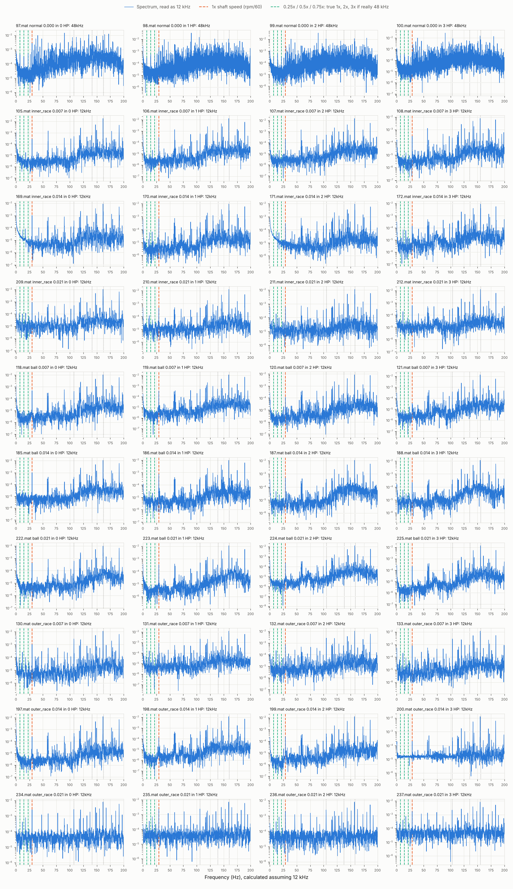
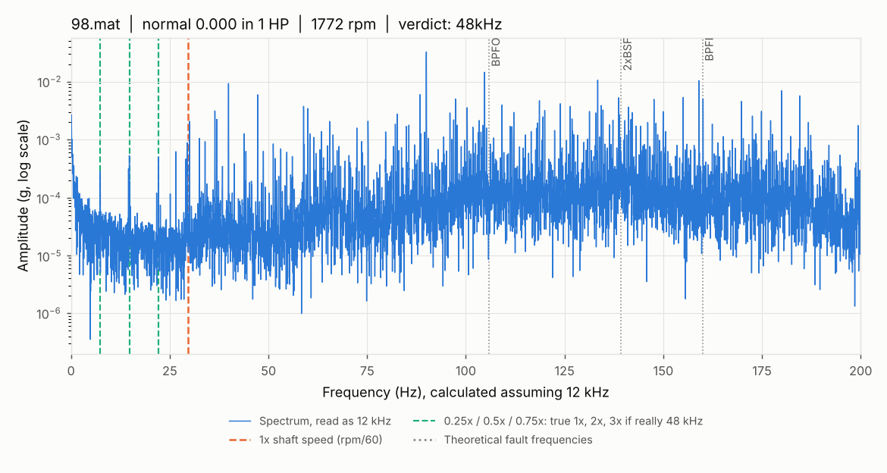
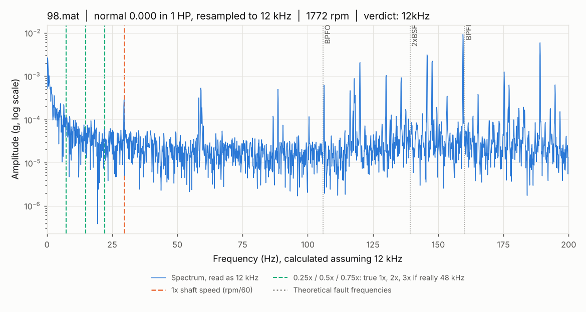
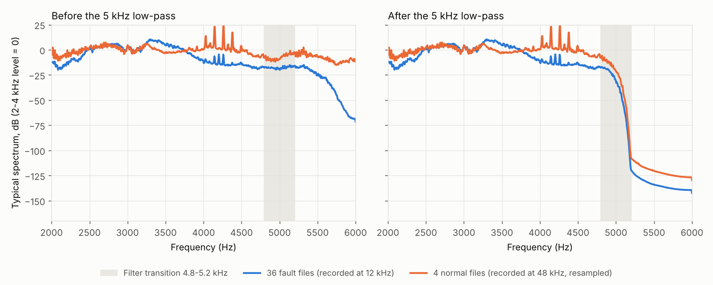
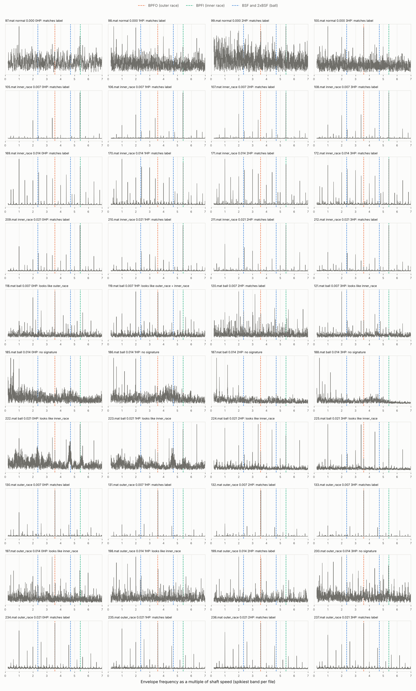

# Validation: version 3.1 (2026-11-02, all 40 files)

This document holds the evidence that each step of the project does what it
claims. Every number here comes from a script in `src/` and is checked by a
test in `tests/`.

**Changes from version 2.1:**
- the label check is now a tested script, `src/check_fault_signatures.py`,
  with a data-driven band choice. It replaces the exploratory one-off
  calculation, and section 4.2 is rewritten from its results;
- the decision to keep CWRU's labels is recorded (section 4.3);
- v3.1: everything is checked against CWRU's official website (section
  1.3). The rig-wide peaks in section 4.1 are now explained.

Version 2 covered all 40 files, settled the two normal-file questions and
added the quarter-order sampling-rate test. Version 2.1 added the 5 kHz
low-pass (section 3.5).

---

## 1. Data inventory and quality

Source: `python -m src.load_data`, which writes `results/manifest.csv` and
`results/data_quality_report.txt`.

### 1.1 What is present

All 40 files are present and readable.

| Condition | Size | Files (0-3 HP) | Stored rpm | Recorded at | Duration |
|---|---|---|---|---|---|
| Normal | none | 97, 98, 99, 100 | 1796, *1772*, *1750*, 1725 | **48 kHz** | 5.1 s (97), 10.1 s (others) |
| Inner race | 0.007 in | 105-108 | 1797, 1772, 1748, 1721 | 12 kHz | 10.1-10.2 s |
| Inner race | 0.014 in | 169-172 | 1796, 1774, 1752, 1728 | 12 kHz | 10.1-10.2 s |
| Inner race | 0.021 in | 209-212 | 1797, 1774, 1752, 1728 | 12 kHz | 10.1-10.2 s |
| Ball | 0.007 in | 118-121 | 1796, 1772, 1748, 1722 | 12 kHz | 10.1-10.2 s |
| Ball | 0.014 in | 185-188 | 1796, 1772, 1749, 1724 | 12 kHz | 10.2 s |
| Ball | 0.021 in | 222-225 | 1796, 1774, 1754, 1729 | 12 kHz | 10.1-10.2 s |
| Outer race @ 6:00 | 0.007 in | 130-133 | 1796, 1773, 1750, 1725 | 12 kHz | 10.1-10.2 s |
| Outer race @ 6:00 | 0.014 in | 197-200 | 1796, 1772, 1749, 1723 | 12 kHz | 10.2 s |
| Outer race @ 6:00 | 0.021 in | 234-237 | 1796, 1771, 1748, 1721 | 12 kHz | 10.2 s |

*Italic* rpm: not stored in the file, so the nominal value is used.

### 1.2 Findings

1. **File 99 contains a copy of file 98.** Besides its own recording
   (`X099_DE_time`), 99.mat holds `X098_DE_time` and `X098_FE_time`. These
   are identical, sample for sample, to the signals in 98.mat.
   - The loader uses the variable named after the file (`X099_DE_time`).
     The copy is reported and ignored, so no file is excluded.
   - 99's own signal is different from every other signal.
   - The srigas `CWRU_Bearing_NumPy` repository reports the same
     duplicate independently (see section 5).
   - 99.mat also contains a stray MATLAB variable called `ans`, which is
     harmless.
2. **There are no other duplicates.** Every drive-end variable in all 40
   files was compared. Apart from the 98/99 copy, no two are identical, and
   none share their first 1,000 samples.
3. **The normal files were recorded at 48 kHz.** Every fault file is 12 kHz.
   They are now resampled to 12 kHz; see section 3.
4. **Two files store no RPM.** 98 and 99 have none, so we use the nominal
   1772 and 1750 rpm. Every other file stores its measured speed.
   - The sampling-rate check finds their shaft peaks at about 1774 and
     1752 rpm, within 2 rpm of nominal, so nominal is a good stand-in.
5. **The 3 HP files run below nominal.** Seven of them (100, 108, 121, 133,
   188, 200, 237) store 1721-1725 rpm against a nominal 1730. That is up
   to 9 rpm (0.5%) lower, and every fault frequency shifts by the same 0.5%.
6. **File 97 is half the length of the others.** It lasts 5.1 s, against
   about 10.1 s for every other file. The normal class therefore has 35 s
   of data in total, against about 40.6 s for each fault group.
7. **The normal files have no base-plate (BA) channel.** Fault files have
   DE, FE and BA. We use only DE, but any model given BA could spot
   "normal" from the missing channel alone.

### 1.3 Checked against CWRU's official website (2026-11-02)

Source: the [Bearing Data Center](https://engineering.case.edu/bearingdatacenter)
pages, read on 2026-11-02:
- [Normal Baseline Data](https://engineering.case.edu/bearingdatacenter/normal-baseline-data)
- [12k Drive End Bearing Fault Data](https://engineering.case.edu/bearingdatacenter/12k-drive-end-bearing-fault-data)
- [Download a Data File](https://engineering.case.edu/bearingdatacenter/download-data-file)
- [Apparatus & Procedures](https://engineering.case.edu/bearingdatacenter/apparatus-and-procedures)
- [Bearing Information](https://engineering.case.edu/bearingdatacenter/bearing-information)
- [Fault Specifications](https://engineering.case.edu/bearingdatacenter/fault-specifications)

What we read is saved in `data/cwru_official_reference.csv`: every file's
official name, size, date and address. Tests compare against it offline, so
the project itself never goes online. No data file was downloaded. File
sizes came from header-only requests, which return the size without the
file.

| Check | Result |
|---|---|
| File number → condition, fault size, load (all 40) | **40/40 match** the official tables. 105 is `IR007_0`, 130 is `OR007@6_0`, 97 is `Normal_0`, and so on. A test re-checks this. |
| File size in bytes (all 40) | **40/40 identical** to the official files. A test re-checks this. This is strong evidence the files are the originals, but not proof; a full checksum would need downloading them. |
| Nominal speeds per load | 1797 / 1772 / 1750 / 1730 rpm: **match** |
| Bearing geometry (6205-2RS JEM) | ball diameter 0.3126 in (7.940 mm) and pitch diameter 1.537 in (39.040 mm): **match** |
| Fault-frequency multipliers | BPFI 5.4152, BPFO 3.5848, rolling element 4.7135: **match**. FTF is published as 0.39828; see section 2.3. |
| Fault depth (all our faults) | 0.011 in, SKF bearings (not used in calculations) |

What the site says that matters to us:
- **Sampling rate:**
  - The site says: "Data was collected at 12,000 samples/second and at
    48,000 samples/second for drive end bearing experiments."
  - The Normal Baseline page **gives no rate at all**. The site never says
    the normal files are 12 kHz, so it does not contradict our finding that
    they are 48 kHz (section 3).
- **Speed:** "Speed and horsepower data were collected using the torque
  transducer/encoder and were **recorded by hand**." So the stored RPM is
  a hand-written reading, which explains why it is always a whole number.
  - The site also says every file contains the motor speed. Files 98 and
    99 do not (section 1.2).
- **Outer-race position: the site contradicts itself.**
  - The 12k data table says "Load Zone Centered at 6:00", with 3:00
    "Orthogonal".
  - The Apparatus & Procedures page says 3 o'clock is "directly in the load
    zone" and 6 o'clock is "orthogonal to the load zone".
  - Our files are the "@6" files either way, so the labels are unaffected.
    But whether these outer-race faults sat in the centre of the load zone
    is uncertain. Earlier versions of this project stated it as fact; they
    no longer do.

---

## 2. Bearing fault frequencies

Source: `src/bearing_physics.py`, tested in `tests/test_bearing_physics.py`.
Unchanged from version 1.

### 2.1 Formulas

Symbols: n = number of balls, d = ball diameter, D = pitch diameter,
φ = contact angle, f_r = shaft speed in Hz (rpm / 60).

| Frequency | Meaning | Formula |
|---|---|---|
| FTF | cage (ball holder) rotation | f_r / 2 × (1 − d/D cos φ) |
| BPFO | balls passing a point on the outer race | n f_r / 2 × (1 − d/D cos φ) |
| BPFI | balls passing a point on the inner race | n f_r / 2 × (1 + d/D cos φ) |
| BSF | one ball spinning about its own axis | D / (2d) × f_r × (1 − (d/D cos φ)²) |

Assumptions: outer race fixed, inner race turning with the shaft, pure
rolling (no slip). Real bearings slip slightly, so measured fault
frequencies are often 1-2% off these values. In this data, BPFI is
measured at 5.40-5.41×, 0.1-0.3% below theory (section 4).

### 2.2 Hand calculation at 1797 rpm

Bearing: n = 9, d = 7.94 mm, D = 39.04 mm, φ = 0°.

1. **Shaft frequency:** f_r = 1797 / 60 = **29.95 Hz**
2. **Geometry ratio:** d/D × cos φ = 7.94 / 39.04 × cos 0° = 0.203381 × 1 = **0.203381**
   - 1 − 0.203381 = 0.796619
   - 1 + 0.203381 = 1.203381
   - 0.203381² = 0.041364, so 1 − 0.041364 = 0.958636
3. **FTF** = 29.95 / 2 × 0.796619 = 14.975 × 0.796619 = **11.929 Hz**
4. **BPFO** = 9 × 29.95 / 2 × 0.796619 = 134.775 × 0.796619 = **107.364 Hz**
5. **BPFI** = 134.775 × 1.203381 = **162.186 Hz**
6. **BSF** = 39.04 / (2 × 7.94) × 29.95 × 0.958636 = 2.458438 × 29.95 × 0.958636 = **70.585 Hz**
7. **2 × BSF** = **141.169 Hz**

Cross-checks that follow from the formulas (both are tests):
- BPFO + BPFI = n × f_r: 107.364 + 162.186 = 269.550 = 9 × 29.95 ✓
- BPFO = n × FTF: 9 × 11.929 = 107.364 ✓

Values at all four nominal speeds are in `results/fault_frequencies.csv`.

### 2.3 Comparison with CWRU's published multipliers

| | Ours (from geometry) | CWRU published | Difference |
|---|---|---|---|
| BPFI | 5.41522 | 5.4152 | +0.00002 |
| BPFO | 3.58478 | 3.5848 | −0.00002 |
| FTF | 0.39831 | 0.39828 | +0.00003 |
| BSF (standard) | 2.35675 | none | none |
| 2 × BSF | 4.71350 | 4.7135 ("rolling element") | −0.000005 |

Every difference is within CWRU's rounding, except a tiny FTF quirk.
CWRU publishes FTF to 5 decimals as 0.39828, but FTF must equal BPFO ÷ 9,
and their own BPFO gives 3.5848 ÷ 9 = **0.39831**, matching ours. Their
published figures are therefore inconsistent by 0.008%, which is negligible.

### 2.4 Finding: CWRU's "rolling element" frequency is 2 × BSF

The standard formula gives **BSF = 2.3567 × shaft speed**. CWRU's published
**4.7135** equals **2 × 2.356748 = 4.713495**, which rounds to 4.7135.

Why 2×: a defect on a ball touches the outer race and then the inner race
during each spin, so it makes **two impacts per ball revolution**. In code
and reports we write **BSF = 2.357×** and **2×BSF = 4.714×**. A test stops
anyone from "correcting" BSF to 4.7135.

---

## 3. Sampling-rate check

Source: `python -m src.check_sampling_rate`, tested in
`tests/test_sampling_rate.py`.

### 3.1 The question

CWRU's fault data is drive-end at 12 kHz. Published sources disagree on
whether the normal baseline is 12 kHz or 48 kHz (section 5). If one class
were at a different rate, a classifier could learn the recording rate
instead of the fault. That would be a leakage shortcut.

### 3.2 Method (version 2)

Every file is read as if it were 12 kHz. If a file was really recorded at
48 kHz, every frequency then comes out 4 times too low.

- **Test A:** is there a clear peak at 1× (rpm/60)?
- **Test B:** how many of the quarter orders, 0.25×, 0.5× and 0.75× shaft
  speed, show a clear peak? A real 12 kHz recording has no physical reason
  to vibrate at those fractions. A 48 kHz file read as 12 kHz does, because
  they are its true 1×, 2× and 3×.

"Clear" means the largest value within ±3% of the location is at least 10
times the median spectrum level within ±30% around it.

| Verdict | Rule |
|---|---|
| 12 kHz | clear 1× peak **and** no quarter-order peaks |
| 48 kHz | clear 0.25× peak **and** at least 2 of the 3 quarter orders |
| inconclusive | anything else; a person must look at the plot |

**Why version 1 was not enough.** Version 1 compared only two locations:
1× (expected if the file is 12 kHz) and 0.25× (where 1× would appear if
it is 48 kHz). On the normal files, both locations passed, so version 1
answered "inconclusive", as designed. The reason is that a 48 kHz file's
true **4×** harmonic lands exactly where a 12 kHz file's 1× would be. A
peak at 1× therefore proves nothing, but a peak at 0.25× has no innocent
explanation. Test B uses that asymmetry.

> **Honesty note:** test B was added *after* seeing the normal files'
> result. It is motivated by the physics above, not tuned to the data.
> It leaves every 12 kHz verdict unchanged. A synthetic test reproduces
> the 4× trap and checks that the method handles it.

### 3.3 Results

**36 fault files are 12 kHz.**
- The 1× peak scores between 13.0 and 219.
- It sits within 0.065 Hz of rpm/60.
- No quarter-order location scores above 4.9 in any of them, against a
  threshold of 10.

The weakest file is 200 (1× ratio 13.0). Its spectrum has a flat noise floor
below about 80 Hz, unlike the others, but its verdict is still clear because
it shows no quarter-order peaks.

**The 4 normal files are 48 kHz:**

| File | rpm | Peak at 0.25× (Hz) | Ratio 0.25× | Ratio 0.5× | Ratio 0.75× | After resampling |
|---|---|---|---|---|---|---|
| 97 | 1796 | 7.477 (expected 7.483) | 12.6 | 13.5 | 23.7 | 12 kHz ✓ |
| 98 | 1772* | 7.390 (expected 7.383) | 11.2 | 30.0 | 31.2 | 12 kHz ✓ |
| 99 | 1750* | 7.298 (expected 7.292) | 12.2 | 30.3 | 20.0 | 12 kHz ✓ |
| 100 | 1725 | 7.190 (expected 7.188) | 12.8 | 20.1 | 14.2 | 12 kHz ✓ |

\* nominal rpm; no RPM is stored in the file.

Two further pieces of evidence point the same way:
- **Mains hum.** In 98 and 99, the peak near the 1× position is at
  **30.0 Hz** regardless of shaft speed (expected 29.53 and 29.17 Hz). At
  48 kHz that is **120 Hz**, twice the 60 Hz US mains frequency, which
  does not depend on shaft speed.
- **Length.** At 48 kHz, files 98-100 last **10.1 s**, the same as every
  fault recording. At 12 kHz they would last 40 s.

Normal file 98, read as 12 kHz. Note the peaks on the green quarter-order
lines:

The same file after resampling from 48 kHz to 12 kHz. The quarter-order
peaks are gone and 1× is in the right place:

### 3.4 What was done about it

- `src/config.py` records 97-100 as 48 kHz, with a comment pointing here.
  A test fails if the config and the check ever disagree.
- `load_data.load_signal()` resamples those files to 12 kHz with
  `scipy.signal.resample_poly`. This low-pass filters below 6 kHz before
  keeping every 4th sample. Keeping every 4th sample without filtering
  would fold 6-24 kHz vibration back into 0-6 kHz (aliasing).
- A test re-checks every signal that `load_signal()` hands out, and all 40
  come out 12 kHz.

### 3.5 Band-edge leakage, and the 5 kHz low-pass that removes it

Source: `python -m src.check_band_edge`, tested in `tests/test_band_edge.py`
and `tests/test_load_data.py`.

**The problem.** Even after resampling, the normal class was recorded
differently from every fault class. Each group went through a different
anti-aliasing filter, so they look different near the top of the band for
reasons that have nothing to do with bearings. Measured:

| Frequency | Resampling filter (normal files) | Typical fault file | Typical normal file |
|---|---|---|---|
| 4.8 kHz | −0.10 dB (flat) | −17.8 dB | −7.9 dB |
| 5.2 kHz | −0.17 dB (flat) | −15.8 dB | −2.9 dB |
| 5.5 kHz | −0.96 dB | −24.3 dB | −6.7 dB |
| 5.8 kHz | −2.38 dB | −51.8 dB | −11.6 dB |
| 5.95 kHz | −3.04 dB | **−67.5 dB** | **−8.9 dB** |

How to read the table:
- The resampling filter is measured by passing random noise through it.
- The "typical" spectra are each group's median, in dB relative to its own
  2-4 kHz level, so the table compares shapes, not loudness.
- The 12 kHz recorder's filter cuts the fault files steeply from about
  5.3 kHz. The normal files stay nearly flat up to 6 kHz.
- At 5.95 kHz the gap is **59 dB**: a shortcut any classifier could find.

**The fix (owner decision, 2026-11-01).** `load_data.load_signal()` now
low-pass filters **every** signal:
- it is a 111-weight FIR filter (Kaiser window), run forwards and backwards
  so nothing is shifted in time;
- it leaves 0-4.8 kHz unchanged (within 0.01 dB, measured);
- it cuts everything above 5.2 kHz by at least 129 dB;
- its −6 dB point (−12 dB after the two passes) is 5.0 kHz.

Why these edges: below 5.2 kHz both recording chains are flat, so the
filter removes only the region where they differ. The fault files' recorder
starts cutting at about 5.3 kHz, and the resampling filter loses less than
0.2 dB below 5.2 kHz.

**Result.** Before the filter, the share of energy above 5.2 kHz was between
−37 and −15 dB in the fault files and between −22 and −18 dB in the normal
files. After it, **every one of the 40 files is below −130 dB**, less than
1 part in 10 trillion. A test checks this for every file.

**What is left, and the rule that follows:**
- **A trace remains above 5.2 kHz.** The normal files still sit about
  10-15 dB above the fault files there, at around −110 dB. That is
  negligible in absolute terms, but a feature that took the logarithm of
  that band could still see it.
  **Rule: features use 0-4.8 kHz only.**
- **The normal files have their own tones inside the kept band.** They
  share a cluster of sharp peaks at 4.1-4.3 kHz that the fault files do
  not have (orange spikes in the figure). Their cause is unknown, and they
  are another possible normal-vs-fault shortcut that filtering cannot
  remove.
- **Other differences remain.** The normal files have no BA channel (we
  use DE only), and file 97 is half length.
- Treat any very high normal-vs-fault accuracy with suspicion, and check
  what the model relies on.

### 3.6 Limits of this check

- The check needs visible shaft harmonics. All 40 files have them.
- A 12 kHz file with a single stray resonance at a quarter order would get
  "inconclusive", not a wrong verdict. A test covers this case.

---

## 4. Observations from looking at the spectra

### 4.1 Both bearings' inner-race frequencies appear in every file, healthy ones included

Source: `python -m src.check_fault_signatures`, columns `raw_*` in
`results/fault_signatures.csv`.

In **all 40 files**, healthy normal files included, the raw spectrum has
clear peaks at:

| Peak | Theory | Found (all 40 files) | Peak / background |
|---|---|---|---|
| Drive-end bearing BPFI | 5.415× | **5.394-5.403×** (median 0.28% below) | 146-1044 |
| Fan-end bearing BPFI (6203, CWRU's figure) | 4.947× | **4.930-4.937×** (median 0.26% below) | 62-433 |

The 5.40× peak is usually the tallest below 200 Hz. A further peak at
6.40× is 5.40× plus one shaft turn.

- **Both peaks sit about 0.27% below theory, the same small slip.** So the
  unexplained rig-wide peaks from version 2 are the **inner-race
  ball-pass frequencies of the two bearings**. That is the fan-end
  bearing's value that the official site lists (section 1.3), and it
  matches.
- They are present in healthy bearings too, so in this data they are part
  of the normal vibration of the rig, not a seeded fault. Small imperfections
  in the races or balls can produce such components; which one does here is
  not established.

**Consequence:** a "raw spectrum amplitude at BPFI" feature cannot tell
anything apart in this data. Physics-informed features must use the
envelope spectrum.

### 4.2 Does each file show its labelled fault?

Source: `python -m src.check_fault_signatures`, tested in
`tests/test_fault_signatures.py`. Results are in
`results/fault_signatures.csv`, and the figure is
`results/figures/fault_signatures_overview.png`.

**Method.** This is envelope analysis, explained in plain English at the
top of the script.
1. **Pick the band.** The band is chosen by **kurtosis**, which measures
   how spiky a signal is. The script tries nine overlapping 1.2 kHz bands
   between 0.4 and 4.8 kHz and keeps the spikiest one. This is the idea
   behind spectral kurtosis and the kurtogram, in its simplest form. It
   uses the signal only, never the label.
2. **Get a second opinion.** A fixed wide band (2.0-4.8 kHz) is analysed
   as well, so one unlucky band choice cannot hide a fault.
3. **Measure the evidence.** For each fault type, the evidence is the
   envelope peak divided by the background around it:
   - outer race: BPFO;
   - inner race: BPFI;
   - ball: BSF or 2×BSF, whichever is stronger.

   The peak is the largest value within ±2% of the fault frequency. The
   background is the median within ±20% around it. A type is **clear** at
   10 or more.
4. **Give the verdict.**
   - A fault file "matches label" if its own type is clear in either band.
     It "looks like X" if only another type is clear, and has "no
     signature" if nothing is clear.
   - A normal file matches if nothing is clear.

**Fixed before looking.** The rules above were fixed and tested on
synthetic signals before the script was run on real data. The positive
controls were also written beforehand: inner race 0.007, outer race 0.007
and normal must pass.

One test was corrected before the real data was run. My first synthetic
band-choice test used an almost noise-free signal. In that case the method
picked a band next to the resonance, because the sharp start of each impact
is spikier than the steady ringing. With realistic noise it picks the
resonance band. I changed the test signal to be realistically noisy, not
the method.

**Synthetic validation.** These are impact trains that ring a 3 kHz
resonance, buried in noise at 0.3 against impacts of 1.
- Outer-race, inner-race and ball signals are each identified correctly,
  and only as that type.
- An outer-race signal given a ball label is flagged "looks like outer
  race".
- Pure noise shows nothing.
- With a loud 1 kHz hum added, the band choice still picks the
  resonance, not the hum.

**Results (primary rules).** Each figure is the evidence in the better of
the two bands.

| Group | BPFO (outer) | BPFI (inner) | Ball (BSF/2×BSF) | Verdicts |
|---|---|---|---|---|
| Normal | 2-6 | 3-5 | 2.5-4 | **4/4 match** (no fault seen) |
| Inner race 0.007 | 4-6 | **212-265** | 14-30* | **4/4 match** |
| Inner race 0.014 | 7-10 | **83-136** | 3-14* | **4/4 match** |
| Inner race 0.021 | 5-9 | **137-172** | 11-31* | **4/4 match** |
| Outer race 0.007 | **551-758** | 4-17 | 19-30* | **4/4 match** |
| Outer race 0.014 | 3-15 | 8-17 | 4-6 | 1 match (199), 2 look like inner race (197, 198), 1 no signature (200) |
| Outer race 0.021 | **89-100** | 3-5 | 4-5 | **4/4 match** |
| Ball 0.007 | 7-23 | 10-22 | 7-10 | 1 match (120, see below), 1 looks like outer race (118), 1 outer + inner (119), 1 inner (121) |
| Ball 0.014 | 2-3 | 2-3 | 3-4 | **0/4**: no signature in any |
| Ball 0.021 | 4-9 | 15-23 | 6-7 | **0/4**: all look like inner race |

**26 of 40 files match their label.** These are all 4 normal, all 12 inner
race, 9 of 12 outer race and 1 of 12 ball.

\* **Ball evidence in non-ball files comes from window overlap, not ball
faults.** The CSV records where each peak was found:
- In inner-race files the "ball" peak sits at **2.40×** shaft speed. That
  is the sideband BPFI − 3× (measured BPFI 5.40×), at the very edge of the
  ±2% BSF window (2.31-2.40×), not at BSF (2.357×).
- In outer-race and inner-race files a further peak at **4.79-4.80×** sits
  at the edge of the 2×BSF window (4.62-4.81×), not at 2×BSF (4.713×).

**Sensitivity check, added after the first run.** Repeating the verdict
with a ±1% window excludes those edge peaks. The window is still wider than
the slip in the clean files (BPFO measured up to 3.61×, BPFI down to 5.40×).
Exactly one verdict changes:
- **Ball file 120 goes from "matches label" to "looks like outer race +
  inner race".** Its only clear ball evidence (10.3) was a peak at 2.399×,
  the inner-race sideband position.
- Under the narrow window **25 of 40 files match, and 0 of 12 ball files
  do.**

The primary result stays the reported one, with this caveat attached.

**What the figure shows that the numbers miss.** Ball files 222 and 223
(0.021 in, 0 and 1 HP) have **broad humps** centred near BSF (2.36×) and
2×BSF (4.71×), not sharp lines. Ball-fault energy often smears like this
because the balls slip and their spin is not steady. The peak/background
measure compares a sharp peak with its surroundings, so it is blind to a
hump that fills those surroundings. **"No signature" therefore means "no
sharp fault line with this method", not "no fault".**

**Summary of the label check:**
- **Normal, inner race (all sizes), outer race 0.007 and 0.021:** the physics
  clearly supports the labels.
- **Outer race 0.014:** 1 of 4 shows BPFO; two show inner-race-like
  evidence instead.
- **Ball:** no file shows a sharp ball line. The 0.021 in files show
  inner-race-like lines (BPFI with shaft sidebands), and two of them also
  show broad humps at BSF and 2×BSF. The 0.014 in files show only
  low-frequency content. That includes a cage-speed (FTF) peak at
  0.395-0.398× with evidence 6-12, but FTF also appears in non-ball files
  (outer-race file 130: 39), so it is not a ball-specific sign.
- This agrees with secondary reports of Smith & Randall's benchmark: ball
  faults are by far the hardest CWRU faults to diagnose (section 5).

### 4.3 Decision: CWRU's labels are kept as published

Owner decision, 2026-11-02. The 14 files above whose verdict is not "matches
label" keep their CWRU labels:
- 11 ball files: 118, 119, 121, all of 185-188 and all of 222-225;
- 3 outer race 0.014 files: 197, 198 and 200.

Why:
- The project evaluates classifiers on the benchmark as it is published.
  Relabelling it would make the results incomparable with the literature.
- The check above has known blind spots: broad humps, and a single
  envelope method.

Consequences for reporting:
- Every result will be broken down **per class** (and per fault size).
- The ball and outer race 0.014 groups will be flagged alongside it.
- A high score on those groups needs a closer look. Either the model found
  something real that this check misses, or it recognises the recording
  rather than the fault. The latter is the leakage this project sets out
  to show.

## 5. Related sources

- CWRU Bearing Data Center, the official data source (pages listed in
  section 1.3, read 2026-11-02).
- Smith, W.A. and Randall, R.B. (2015), *Rolling element bearing diagnostics
  using the Case Western Reserve University data: a benchmark study*,
  Mechanical Systems and Signal Processing 64-65, 100-131,
  doi:10.1016/j.ymssp.2015.04.021.
  ([ResearchGate](https://www.researchgate.net/publication/276248554_Rolling_Element_Bearing_Diagnostics_Using_the_Case_Western_Reserve_University_Data_A_Benchmark_Study))
  - **Not yet read in full.** The statements here come from search
    summaries: ball faults were "by far the most difficult to diagnose";
    BSF is hard to separate from 2× shaft speed; impulsive events from
    mechanical looseness affected results more than fault size.
  - The claim that many ball and 0.014 in outer-race defects are hard to
    find with envelope analysis comes from a secondary write-up
    ([zenn.dev](https://zenn.dev/logicia32/articles/2026-07-09-bearing-envelope-leak?locale=en))
    and has not been checked against the paper.
- The 98/99 duplicate is reported independently in
  [srigas/CWRU_Bearing_NumPy](https://github.com/srigas/CWRU_Bearing_NumPy).
- Sources disagree on the normal files' rate. For example,
  [arXiv:2412.01322](https://arxiv.org/pdf/2412.01322) lists them as
  48 kHz, while others treat them as 12 kHz. Section 3 settles it from the
  data.

---

## 6. Open items

| Item | Status |
|---|---|
| Normal files 12 vs 48 kHz | **resolved: 48 kHz**, resampled to 12 kHz |
| Duplicate normal file | **resolved**: copy of 98 inside 99.mat, reported and not used |
| Envelope label check as a tested script | **done**: `src/check_fault_signatures.py` (section 4.2) |
| Band choice for the envelope check | **done**: spikiest of nine 1.2 kHz bands (kurtosis), plus a fixed 2.0-4.8 kHz band |
| Labels of the 14 files without a matching signature | **decided**: keep CWRU labels, report per class (section 4.3) |
| Ball faults as broad humps, not sharp lines | not captured by the peak measure; consider a band-energy measure for physics features |
| Peaks at 2.40× and 4.79-4.80× in non-ball files | explained for 2.40× (BPFI − 3×); 4.79-4.80× origin not established |
| Low-pass all signals at about 5 kHz to remove the 48 kHz band-edge difference | **done**: 4.8/5.2 kHz FIR in `load_signal()`, verified on all 40 files |
| Normal-only tones at 4.1-4.3 kHz (possible shortcut inside the kept band) | unexplained; watch for it in feature importance |
| Rig-wide raw peaks at 5.40× and 4.93× | **explained**: inner-race frequencies of the drive-end and fan-end bearings (section 4.1). Physical source not established. |
| Files match the official website | **checked**: 40/40 names and 40/40 sizes (section 1.3) |
| Is the 6:00 outer-race position in the load zone? | official site contradicts itself (section 1.3) |
| Read Smith & Randall (2015) in full | to do |
